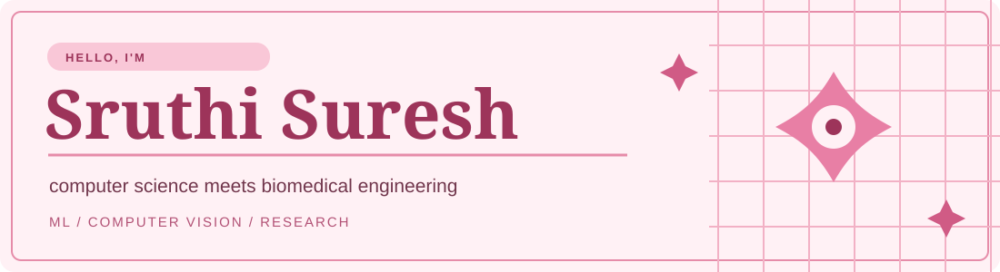
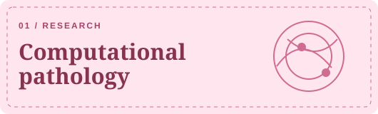

Computer science → biomedical engineering.  
I work on machine learning problems where the data is difficult, the evaluation matters, and the answer isn't always a bigger model.

Currently studying biomedical engineering at the National University of Singapore.

### Selected work

<table><tr><td width="50%"></td><td width="50%"></td></tr></table>

**01 / [Mapping pathology across the mouse brain](https://github.com/sruthicodesthings/computational-pathology)**  
*Computational pathology · EPFL research*

An image-analysis workflow for multi-terabyte fluorescence microscopy: annotation, Attention U-Net segmentation, tiled inference, atlas registration, and spatial quantification.

   

Inside the project ↗

- Large microscopy images processed in tiles rather than loaded all at once.
- Manual pathology annotations and hard negatives for model training.
- Segmentation outputs mapped into anatomical coordinates.
- Public repository documents a reconstruction of historical research work, not the original laboratory code.

[Read the case study](https://github.com/sruthicodesthings/computational-pathology#readme)

**02 / [Predicting ICU transfer from hospital records](https://github.com/sruthicodesthings/mimic-iv-icu-prediction)**  
*Clinical machine learning · MIMIC-IV*

A retrospective study of ICU-transfer risk, spanning temporal feature engineering, model comparisons, calibration, competing risks, and an interactive research demo.

   

Inside the project ↗

- Cohorts and features built around defined prediction landmarks.
- Audits for leakage, patient separation, and feature availability.
- Experiments across multiple model families and prediction formulations.
- Research prototype only; no clinical deployment or validation claim.

[Read the research archive](https://github.com/sruthicodesthings/mimic-iv-icu-prediction#readme)

---

**Elsewhere:** [Repositories](https://github.com/sruthicodesthings?tab=repositories) · [LinkedIn](https://www.linkedin.com/search/results/people/?keywords=Sruthi%20Suresh)

<!-- Custom SVG artwork is stored in this repository. Technology labels are rendered by shields.io. -->
